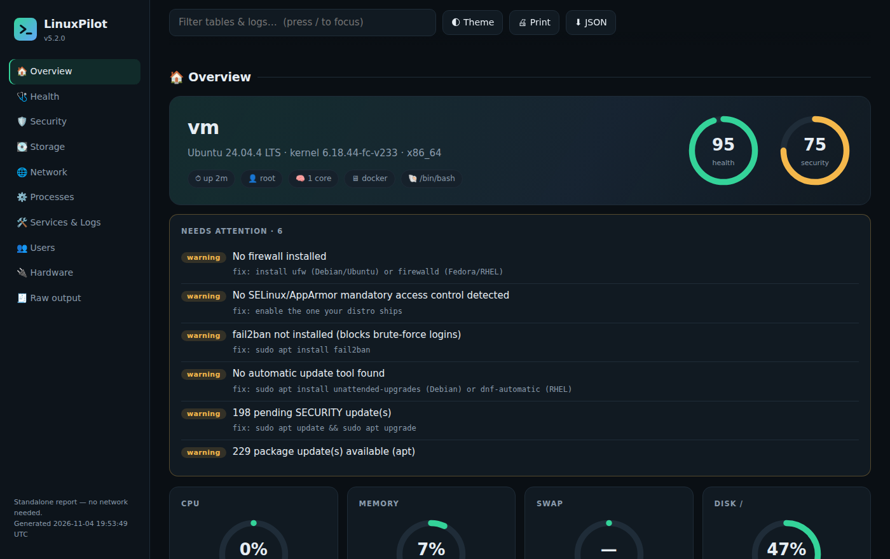

<p align="center"></p>

<p align="center">
  
  
  
</p>

**LinuxPilot** is a menu-driven toolkit for Linux, written in plain bash.
It helps **beginners** learn how things are done, helps **admins** manage a machine from one place, and gives everyone a clear picture of what is going on — including a standalone HTML dashboard.

## Install

```bash
git clone https://github.com/MS-X01/linuxpilot.git
cd linuxpilot
./linuxpilot              # run from the folder
sudo ./install.sh         # or install for everyone  (./install.sh = just for you)
```

Needs only **bash 4+**. Everything else is optional — LinuxPilot tells you if a tool is missing.

## What's inside

| Section | What you can do |
|---|---|
| **🎓 Linux Academy** | Ask "how do I…?", read cheat sheets, explain any command, tour the filesystem |
| **🩺 Health Check** | One-screen check of disk, memory, load, services, updates |
| **📊 System Information** | CPU, memory, disks, OS, hardware, temperatures |
| **👤 User Management** `[sudo]` | Create, delete, edit users and groups, grant sudo, lock accounts |
| **📁 Files & Directories** | Browse, copy, move, find, search inside files, archive |
| **🔧 Process Management** | Monitor, search, stop programs, change priority |
| **🌐 Network Tools** | IPs, open ports, ping, DNS, traceroute, port and web checks |
| **📦 Package Manager** `[sudo]` | apt, dnf, yum, pacman, zypper behind one menu |
| **🔰 Security & Firewall** `[sudo]` | ufw / firewalld, failed logins, SSH settings, SUID files |
| **💾 Disk Management** | Devices, mounts, big folders, SMART health |
| **🔒 Permissions Manager** | chmod / chown with checks, plus a permission calculator |
| **📋 System Logs** | System, auth, kernel and journal logs, search, live follow |
| **⏰ Cron Jobs & Timers** | Add scheduled jobs step by step |
| **💻 Service Manager** `[sudo]` | Start, stop, restart and enable systemd services |
| **🔑 SSH Key Manager** | Create keys, install them on servers, test connections |
| **💿 Backup** | Dated tar.gz snapshots, restore, keep the last N |
| **🐳 Docker** | Containers, images, logs, cleanup (shown only if Docker is installed) |
| **📄 System Report** | Interactive HTML dashboard or a plain text report |
| **📑 Audit & Compliance** | Security audit with score, "what changed?" comparison, activity log, auditd |
| **🔩 Settings** | Learn mode, dry-run, confirmations |

`[sudo]` marks sections that mostly need administrator rights. LinuxPilot asks for your password only when an action needs it. Press **s** in the main menu to search every feature by keyword.

## HTML dashboard

`linuxpilot --report html` creates **one file** you can open in any browser, offline: health and security scores, usage gauges, sortable tables, open ports, processes, logs, and a "needs attention" list with a fix for each item.

<p align="center"></p>

## Command line

```text
linuxpilot                   open the menu
linuxpilot --learn           explain every command before it runs
linuxpilot --how disk full   search the recipe book
linuxpilot --doctor          health check      (exit 1 if there are problems)
linuxpilot --audit           security audit    (exit 1 on serious findings)
linuxpilot --report html     HTML dashboard    (or: --report text)
linuxpilot --dry-run         show commands, never run them
```

## Good to know

- Every action **shows the exact command** it runs, so you learn as you go.
- **Dry-run** mode changes nothing. Dangerous actions ask you to type `yes`.
- For the most complete audit or report, run it with `sudo`.
- Settings live in `~/.config/linuxpilot/`, the activity log in `~/.local/state/linuxpilot/`.


## Add your own module

One file in `modules/` is a new menu entry:

```bash
# modules/21-hello.sh
hello()      { header "Hello"; run "Say hi" echo hi; pause; }
hello_menu() { menu "Hello" "$C" "Say hi|hello"; }
register_module "Hello" hello_menu
```

More in [CONTRIBUTING.md](CONTRIBUTING.md).

## License

MIT — made by Mohammad Sadra Naderi ([@MS-X01](https://github.com/MS-X01)).
